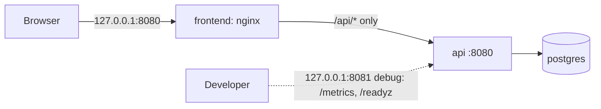

# taskflow-app

Application repository for **TaskFlow**: a deliberately simple task/request manager used to exercise
deployment, persistence, monitoring and recovery on Kubernetes.

Deployment, infrastructure and all architecture decisions live in
[`taskflow-platform`](https://github.com/TavoA2/taskflow-platform) (see its `docs/adr/`, starting with
ADR-0001 for why the code and platform are split).

## Components

| Component | Description | Status |
|-----------|-------------|--------|
| API | Go REST service: task CRUD, `/healthz`, `/readyz`, `/metrics` | Implemented + Tested (steps 1.1-1.4) |
| Frontend | Static HTML/CSS/JS served by nginx (non-root), reverse proxy for `/api/` only | Implemented + Tested (step 1.6) |
| Database | PostgreSQL 18 with goose migrations run as a one-shot `migrate` step | Implemented + Tested (step 1.2) |
| App CI | Lint, test, build, Trivy scan + SBOM, push to GHCR tagged by commit SHA | Planned (Phase 2) |

## Status

| Phase | Scope | Status |
|-------|-------|--------|
| 0 | Repo skeleton, pinned tools, `make bootstrap` | Implemented, Tested (evidence: `taskflow-platform/docs/test-results/phase-0-workstation.md`) |
| 1 | API + frontend + Postgres via docker compose, migrations, tests | In progress (steps 1.1-1.6 done; 1.7 smoke test and evidence pending) |
| 2 | App CI pipeline | Planned |

## Prerequisites

Windows 11 + WSL2 (Ubuntu) + Docker Desktop with WSL integration. Work inside `~/code/...`.

| Tool | Version | Install (Ubuntu) |
|------|---------|------------------|
| docker | managed by Docker Desktop | Docker Desktop > Settings > Resources > WSL integration |
| git, make, curl, jq | distro packages | `sudo apt-get install -y git make curl jq` |
| Go | see `.tool-versions` | `curl -fLo /tmp/go.tgz https://go.dev/dl/go1.27.3.linux-amd64.tar.gz && sudo rm -rf /usr/local/go && sudo tar -C /usr/local -xzf /tmp/go.tgz`, then add `/usr/local/go/bin` to `PATH` |

## Usage

```bash
make help        # list targets
make bootstrap   # verify the workstation; exit code 0 = READY
make fmt vet     # formatting and static analysis
make test        # unit tests (fast, no Docker)
make test-integration  # unit + integration tests against a real PostgreSQL container (needs Docker)
make api-image   # build taskflow-api:<git sha>[-dirty]
```

## Local stack (docker compose)

```bash
make up              # creates .env if missing; postgres -> migrate -> api -> frontend
make ps              # `migrate` should show "Exited (0)"
make migrate-status  # applied / pending migrations
make psql            # SQL shell inside the postgres container
make down            # stop; the pgdata volume (your data) is kept
```



- **App**: <http://127.0.0.1:8080> (`WEB_PORT`). **API debug port**: `127.0.0.1:8081` (`API_PORT`), for `/metrics`
  and `/readyz`; the frontend never exposes those. PostgreSQL is not published to the host.
- Migrations live in `api/internal/migrations/` and are embedded in the binary; `migrate` is the same
  image as `api` with a different command. A failed migration stops the stack before the API starts.
- `docker compose down -v` **deletes the database volume**; use it only to reset local data deliberately.

## Frontend

Plain HTML/CSS/JavaScript in `frontend/public/` (no build step), served by `nginx-unprivileged` (UID 101).

- User data is rendered with `textContent` only, never `innerHTML`; a strict Content-Security-Policy
  (`script-src 'self'`, no inline code) blocks injected scripts as a second layer.
- nginx proxies `/api/` to `API_UPSTREAM` and resolves that name per request (`resolver`, 10s cache), so it starts
  without the API and follows it to a new address when the container or pod is replaced. In Kubernetes,
  `API_UPSTREAM` must be a FQDN (`http://api.<namespace>.svc.cluster.local:8080`): the `resolver` directive does not
  apply DNS search domains.
- nginx forwards `X-Request-ID` (the caller's, or a generated one) to the API and logs it, so one ID links the edge
  and API log lines. Error messages in the UI show it for support.
- Request bodies above 64 KB are rejected at the edge (413), matching the API's own limit.

## API endpoints

| Method and path | Success | Errors |
|-----------------|---------|--------|
| `GET /api/v1/tasks?limit=20&offset=0` | 200 `{"items":[...],"limit":20,"offset":0}` newest first; `limit` 1-100 | 400 |
| `POST /api/v1/tasks` `{"title","description"?,"status"?}` | 201 + `Location` header | 400 |
| `GET /api/v1/tasks/{id}` | 200 | 400 (not a UUID), 404 |
| `PATCH /api/v1/tasks/{id}` (any subset of fields) | 200 | 400, 404 |
| `DELETE /api/v1/tasks/{id}` | 204 | 400, 404 |
| `GET /healthz` | 200 (liveness; never checks the database) | |
| `GET /readyz` | 200 `{"status":"ready"}` | 503 `unavailable` (database ping failed, 1s timeout) or `shutting_down` (after SIGTERM) |
| `GET /metrics` | Prometheus text format | |

`/healthz`, `/readyz` and `/metrics` are outside `/api/`, so the frontend proxy (which forwards only
`/api/`) does not expose them publicly.

Rules: `title` 1-200 characters (trimmed), `description` up to 2000, `status` one of `todo`, `in_progress`, `done`
(default `todo`). Unknown JSON fields are rejected. A JSON `null` in a PATCH is treated as "not provided".

Every error has the same shape; internal errors never expose details (they are logged server-side):

```json
{"error": "validation failed", "code": "validation_failed", "fields": {"title": "is required"}}
```

Codes: `validation_failed`, `bad_request`, `not_found`, `internal`.

## Testing

| Level | Command | Scope | Needs |
|-------|---------|-------|-------|
| Unit | `make test` | Domain validation, HTTP handlers (in-memory fake store), middleware, probes, metrics | Go |
| Integration | `make test-integration` | `store` and `migrations` against PostgreSQL (same image as compose) via testcontainers-go | Go + Docker |

Integration tests carry the `integration` build tag, so `go test ./...` stays fast and Docker-free.
`internal/testdb` starts one container per test package and creates a fresh database per test, so tests are
isolated and run in parallel. Set `TEST_POSTGRES_IMAGE` to test against another PostgreSQL version.

What the integration tests prove beyond the unit tests:

- Migrations: schema and named CHECK constraints exist; `up` is idempotent; every migration rolls back and
  re-applies; `up` blocks while another session holds the migration lock.
- Store: partial updates keep untouched fields and advance `updated_at`; concurrent PATCHes of different fields
  never lose a write (a read-modify-write implementation fails this test); database constraints reject invalid
  data even when application validation is bypassed, counting characters the same way as the domain rules.

## Observability

**Metrics** (`/metrics`):

| Metric | Type | Labels | Purpose |
|--------|------|--------|---------|
| `http_requests_total` | counter | `method`, `route`, `code` | Rate and errors (RED) |
| `http_request_duration_seconds` | histogram | `method`, `route` | Latency (RED) |
| `http_requests_in_flight` | gauge | | Concurrency |
| `taskflow_db_pool_{acquired,idle,total,max}_conns` | gauge | | Pool utilization (USE) |
| `taskflow_db_pool_empty_acquires_total`, `..._empty_acquire_wait_seconds_total` | counter | | Pool saturation: requests that waited for a connection |
| `taskflow_build_info` | gauge | `version`, `goversion` | Which build is running |
| `go_*`, `process_*` | various | | Runtime and process |

Label values are bounded: `route` is the matched pattern (`/api/v1/tasks/{id}`, or `unmatched`), never the raw
path; unknown HTTP methods become `OTHER`.

**Logs**: JSON to stdout, one `http request` line per request with `request_id`, `method`, `route`, `path`,
`status`, `duration_ms`, `bytes`. Probe and scrape requests log at debug level. The query string is not logged.
`X-Request-ID` is accepted from the caller if safe (≤64 chars, `[A-Za-z0-9._-]`), otherwise generated, and
always returned in the response; error logs carry the same ID.

**Shutdown sequence** on SIGTERM: `/readyz` returns 503 → keep serving for `DRAIN_DELAY` → stop accepting,
finish in-flight requests within `SHUTDOWN_TIMEOUT` → close the database pool.

## API configuration

All configuration comes from environment variables.

| Variable | Default | Purpose |
|----------|---------|---------|
| `HTTP_ADDR` | `:8080` | Listen address |
| `DATABASE_URL` | (none) | PostgreSQL URL; required by `serve` and `migrate`. Contains credentials: never logged. Pool tuning via URL params (e.g. `pool_max_conns`) |
| `LOG_LEVEL` | `info` | `debug`, `info`, `warn`, `error` |
| `DRAIN_DELAY` | `5s` | Time to keep serving after SIGTERM while traffic is moved away |
| `SHUTDOWN_TIMEOUT` | `15s` | Time allowed for in-flight requests after draining |

`DRAIN_DELAY + SHUTDOWN_TIMEOUT` must stay below the orchestrator's grace period
(Kubernetes `terminationGracePeriodSeconds`, default 30s; compose `stop_grace_period`, default 10s).
